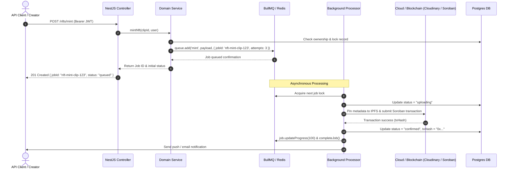
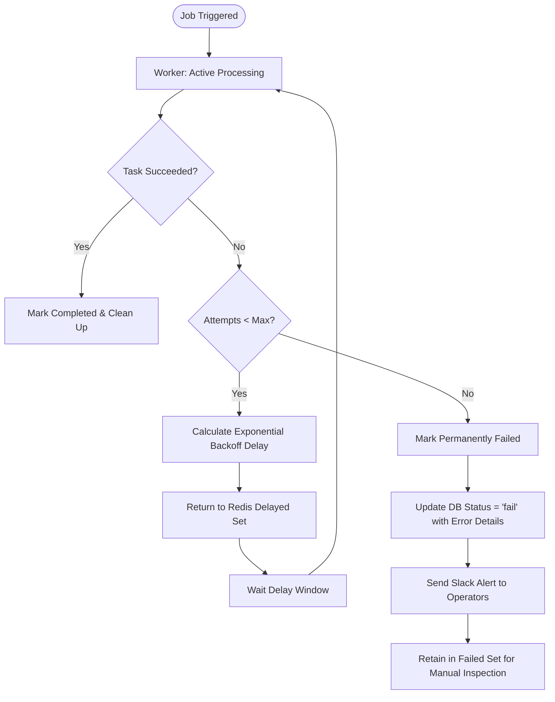

# Queue Architecture

Comprehensive guide to the ClipCash asynchronous queue and worker architecture (Issues #924, #973, #1277).
This system is powered by [BullMQ](https://docs.bullmq.io/) backed by [Redis](https://redis.io/) and orchestrated within NestJS.

---

## Table of Contents

1. [Architectural Overview](#1-architectural-overview)
2. [Redis Architecture & Topology](#2-redis-architecture--topology)
3. [BullMQ Architecture & Job Model](#3-bullmq-architecture--job-model)
4. [Queues & Worker Processors](#4-queues--worker-processors)
5. [Concurrency Configuration](#5-concurrency-configuration)
6. [Retry Policies & Backoff Strategies](#6-retry-policies--backoff-strategies)
7. [Dead-Letter Handling & Permanent Failures](#7-dead-letter-handling--permanent-failures)
8. [Queue Cleanup & Job Retention](#8-queue-cleanup--job-retention)
9. [Queue Monitoring & Observability](#9-queue-monitoring--observability)
10. [Scaling Recommendations](#10-scaling-recommendations)
11. [Architecture & Sequence Diagrams](#11-architecture--sequence-diagrams)
12. [Queue API Reference (Swagger & Endpoints)](#12-queue-api-reference)
13. [Developer FAQ & Acceptance Criteria Reference](#13-developer-faq--acceptance-criteria-reference)
14. [Troubleshooting Guide](#14-troubleshooting-guide)

---

## 1. Architectural Overview

ClipCash decouples long-running, CPU-intensive, or I/O-bound tasks from HTTP request/response lifecycles using BullMQ queues backed by Redis.

When an API controller receives an asynchronous work request (such as video rendering, NFT minting, transactional email dispatch, or blockchain settlement), it:
1. Validates the request DTO and verifies user authorization and balance.
2. Enqueues a typed job into the appropriate BullMQ queue with deterministic identifiers where deduplication is required.
3. Returns an HTTP `201 Created` or `202 Accepted` response with a tracking identifier (`jobId` or entity ID).
4. Asynchronous worker processes pick up the job, execute tasks against external systems (Cloudinary, FFmpeg, Soroban RPC, SMTP), update entity states, and trigger notifications on completion or failure.

---

## 2. Redis Architecture & Topology

Redis functions as the shared persistence, coordination, and pub/sub layer for BullMQ.

### Connection & Configuration

All queue Redis connections are managed by `QueueConfigService` (`src/queue/queue-config.service.ts`) and `RedisService` (`src/redis/redis.service.ts`):

- **Host & Port:** Configured via `QUEUE_REDIS_HOST` (default `localhost`) and `QUEUE_REDIS_PORT` (default `6379`).
- **Authentication:** `QUEUE_REDIS_USERNAME` and `QUEUE_REDIS_PASSWORD`.
- **Database Separation:** Configured via `QUEUE_REDIS_DB` (default `0`). In production, use dedicated DB indexes or separate Redis instances to prevent key collision between caching and job persistence.
- **TLS:** Enabled when `QUEUE_REDIS_TLS=true` or when connecting to AWS ElastiCache / Redis Cloud with SSL.
- **Prefix Isolation:** All queue keys are prefixed with `QUEUE_PREFIX` (default `clips`) resulting in BullMQ namespaces like `clips:clip-generation:*` and `clips:nft-mint:*`.

### Memory Management & Eviction Policies

- **Eviction Policy:** Redis **MUST** be configured with `maxmemory-policy noeviction`. If Redis evicts BullMQ keys under memory pressure, jobs, locks, and stream metadata will be corrupted, resulting in silent job loss.
- **Persistence:** In production, enable Redis AOF (Append-Only File) with `appendfsync everysec` alongside RDB snapshots to guarantee job persistence across Redis restarts.

### Redis Health & Performance Monitoring

- **Latency:** Monitored via Redis `LATENCY LATEST` and `SLOWLOG GET 20`.
- **Memory Usage:** Monitored via `INFO memory` (inspect `used_memory`, `used_memory_rss`, `mem_fragmentation_ratio`).
- **Connection Count:** Monitored via `INFO clients` (`connected_clients`, `blocked_clients`).
- **Queue Key Health:** Monitored via keyspace hits and memory footprint of `bull:<queue>:*` hash sets and zsets.

---

## 3. BullMQ Architecture & Job Model

BullMQ uses Redis Streams, Hashes, and Sorted Sets (ZSETs) to coordinate job transitions safely without race conditions.

### Global Module Registration

`QueueModule` (`src/queue/queue.module.ts`) is marked `@Global()` and initializes BullMQ via `BullModule.forRootAsync`:

```typescript
BullModule.forRootAsync({
  imports: [QueueConfigModule],
  useFactory: (config: QueueConfigService) => ({
    connection: config.redisConnectionOptions,
    prefix: config.prefix,
  }),
  inject: [QueueConfigService],
});
```

### Job States

A job transitions through the following discrete lifecycle states:

```
[Created] ---> [waiting] -----------> [active] ----------> [completed]
                  |                     |
                  v (delay/backoff)     v (error with retries remaining)
              [delayed] <---------------+
                  |
                  v (retries exhausted)
               [failed]
```

- **waiting:** Job queued in Redis list/stream awaiting an available worker slot.
- **active:** Job lock acquired by a worker; job processor currently executing.
- **delayed:** Job scheduled for future execution or in exponential backoff delay between retry attempts.
- **completed:** Job processor executed successfully; output stored in Redis hash according to retention policy.
- **failed:** Job processor threw an unhandled exception or timed out; either rescheduled to `delayed` or marked permanently failed.
- **prioritized:** BullMQ priority-ranked queue position (1 = highest priority).

### Priority Scheduling

Queue jobs support 4 priority tiers (`JobPriorityLevel` in `src/queue/job-priority.ts`):
- `CRITICAL` (priority value 1): Admin overrides and urgent settlement.
- `HIGH` (priority value 2): User-facing interactive operations (video clip rendering).
- `NORMAL` (priority value 3): Default standard operations.
- `LOW` (priority value 4): Background analytics, anomaly detection, monthly aggregation.

### Deduplication

To prevent duplicate job execution, services assign deterministic `jobId`s to idempotent jobs. For example, NFT minting uses `jobId = nft-mint-clip-${clipId}`. If a second request attempts to enqueue with an existing active or waiting `jobId`, BullMQ rejects or ignores the duplicate.

---

## 4. Queues & Worker Processors

| Queue Name | Worker Processor File | Default Priority | Typical Workload |
|------------|-----------------------|------------------|------------------|
| `clip-generation` | `src/clips/clip-generation.processor.ts` | HIGH (2) | FFmpeg video clipping, audio normalization, thumbnail generation, Cloudinary uploads |
| `clip-posting` | `src/clips/clip-posting.processor.ts` | NORMAL (3) | Cross-posting clips to social platforms (TikTok, YouTube Shorts, Instagram) |
| `nft-mint` | `src/clips/nft-mint.processor.ts` | HIGH (2) | IPFS metadata pinning, Soroban smart contract minting, transaction submission |
| `email-delivery` | `src/auth/email-delivery.processor.ts` | NORMAL (3) | Verification emails, password reset, magic links, admin queue health alerts |
| `anomaly-detection`| `src/earnings/anomaly-detection.processor.ts`| LOW (4) | Scanning daily creator earnings for fraudulent activity and spikes |
| `payout-retry` | `src/payouts/payout-retry.processor.ts` | NORMAL (3) | Retrying failed fiat bank transfers and webhook dispatch |
| `stellar-confirmation`| `src/payouts/stellar-confirmation.processor.ts`| NORMAL (3) | Polling Stellar Horizon for on-chain transaction hash confirmations |

---

## 5. Concurrency Configuration

Concurrency determines how many jobs an individual worker instance processes simultaneously.

- **`clip-generation` (concurrency: 2):** CPU and memory intensive (video encoding). Restricting concurrency prevents out-of-memory (OOM) worker crashes.
- **`clip-posting` (concurrency: 5):** I/O bound network calls to social network APIs.
- **`nft-mint` (concurrency: 1):** Strictly serialized per signing wallet. Blockchain sequence numbers (nonces) on Stellar Soroban require deterministic sequencing; executing parallel mints from the same admin address risks sequence number collisions and failed transactions.
- **`email-delivery` (concurrency: 10):** Network I/O to SMTP / SendGrid. High throughput with low memory overhead.
- **`anomaly-detection` (concurrency: 2):** Database read-heavy batch aggregation queries.
- **`stellar-confirmation` (concurrency: 5):** Non-blocking HTTP polling to Stellar Horizon.

---

## 6. Retry Policies & Backoff Strategies

Retry configurations are defined centrally in `RetryBackoffConfigService` (`src/queue/retry-backoff-config.service.ts`) and configured per queue:

| Queue | Max Attempts | Backoff Type | Initial Delay | Max Delay |
|-------|--------------|--------------|---------------|-----------|
| `clip-generation` | 3 | Exponential | 1,000 ms (1s) | 30,000 ms (30s) |
| `clip-posting` | 5 | Exponential | 2,000 ms (2s) | 60,000 ms (60s) |
| `nft-mint` | 3 | Exponential | 2,000 ms (2s) | 30,000 ms (30s) |
| `email-delivery` | 5 | Exponential | 500 ms (0.5s)| 10,000 ms (10s) |
| `anomaly-detection`| 2 | Fixed | 5,000 ms (5s) | 5,000 ms (5s) |
| `payout-retry` | 5 | Exponential | 5,000 ms (5s) | 300,000 ms (5m) |

### Exponential Backoff Calculation

$$delay = \min(initialDelay \times 2^{attempt - 1}, maxDelay)$$

This prevents cascading thundering-herd load against third-party APIs during outages.

---

## 7. Dead-Letter Handling & Permanent Failures

When a job exhausts all allowed retry attempts:

1. BullMQ moves the job to the `failed` state.
2. The processor's `@OnWorkerEvent('failed')` handler logs the full stack trace, failure reason, and execution context.
3. Database status columns (such as `NftMintStatus.status = 'fail'`, `Payout.status = 'failed'`) are updated with the error message and timestamp.
4. `FailedJobNotificationService` logs a structured audit event.
5. If Slack alerts are configured (`SLACK_QUEUE_WEBHOOK_URL`), `SlackNotificationService` sends an alert payload containing queue name, job ID, attempts made, and error stack trace.
6. For critical financial or minting jobs (`removeOnFail: false`), the job data and stack trace are retained indefinitely in Redis for administrative review and manual retry.

---

## 8. Queue Cleanup & Job Retention

To prevent unbounded Redis memory expansion, retention policies are configured via `removeOnComplete` and `removeOnFail`:

- **Transactional / Ephemeral Jobs (`email-delivery`):**
  - `removeOnComplete: true` (or count-based: keep last 100).
  - `removeOnFail: 500` (retains last 500 failed emails for debugging).
- **Audited Financial / Blockchain Jobs (`nft-mint`, `payout-retry`):**
  - `removeOnComplete: { age: 86400, count: 1000 }` (retained for 24 hours or up to 1,000 completed records).
  - `removeOnFail: false` (never automatically deleted; preserved for operator audit).
- **Scheduled Cleanup:**
  - `QueueCollectorService` periodically inspects queue counts.
  - Administrators can invoke `POST /admin/queues/:name/clean` to purge completed jobs older than a specified duration.

---

## 9. Queue Monitoring & Observability

Observability is maintained through three primary channels:

1. **REST Health Endpoints:** `GET /queue/health` provides real-time counts across waiting, active, completed, failed, and delayed states.
2. **Prometheus Metrics:** Exposed at `/metrics` (authenticated via `x-metrics-token`):
   - `clipcash_queue_job_count{queue, state}`
   - `clipcash_queue_job_duration_seconds{queue, status}`
   - `clipcash_queue_job_failures_total{queue, reason}`
   - `clipcash_queue_job_completions_total{queue}`
   - `clipcash_queue_failure_rate{queue}`
   - `clipcash_queue_depth{queue}`
   - `clipcash_queue_worker_memory_rss_bytes`
3. **Queue Dashboard:** Built-in UI dashboard (`src/queue-dashboard/`) mounted at `/admin/queues` for real-time visualization of queue depth and manual job retries.

---

## 10. Scaling Recommendations

1. **Worker Process Decoupling:** In containerized deployments (Kubernetes / ECS), separate the HTTP API server from background workers. Run worker containers with `MODE=worker` to ensure heavy video transcoding does not degrade API response times.
2. **Queue Sharding:** Run dedicated worker pods for CPU-intensive queues (`clip-generation`) separate from blockchain operations (`nft-mint`).
3. **Horizontal Pod Autoscaling (HPA):** Scale worker pods based on queue depth metrics (`clipcash_queue_depth` = `waiting + delayed` jobs). Recommended scale-up trigger: queue depth > 20 per pod for 2 consecutive minutes.
4. **Redis High Availability:** Deploy Redis with Sentinel or AWS ElastiCache Multi-AZ with automated failover. Keep queue persistence on a dedicated Redis cluster distinct from volatile session/HTTP caches.

---

## 11. Architecture & Sequence Diagrams

### End-to-End Async Job Flow



### Retry & Dead-Letter Flow



---

## 12. Queue API Reference

All endpoints require JWT Bearer authentication (`Authorization: Bearer <token>`) except where metrics tokens apply. Base path is `/api`.

### 1. Queue Health

- **`GET /queue/health`**
  - **Summary:** Retrieve operational health and job counts for all registered queues.
  - **Auth:** Bearer JWT (Admin or Monitor).
  - **200 OK Response:**
    ```json
    {
      "status": "healthy",
      "queues": [
        {
          "name": "clip-generation",
          "waiting": 3,
          "active": 2,
          "completed": 1420,
          "failed": 4,
          "delayed": 1,
          "paused": false
        },
        {
          "name": "nft-mint",
          "waiting": 0,
          "active": 1,
          "completed": 350,
          "failed": 2,
          "delayed": 0,
          "paused": false
        }
      ],
      "timestamp": "2026-11-24T01:25:00.000Z"
    }
    ```
  - **401 Unauthorized:** Missing or expired bearer token.

---

### 2. Job Status & Progress

- **`GET /queue/jobs/:jobId`**
  - **Summary:** Query generic BullMQ job state and progress percentage.
  - **Auth:** Bearer JWT.
  - **Parameters:** `jobId` (path param, e.g. `nft-mint-clip-42`).
  - **200 OK Response:**
    ```json
    {
      "jobId": "nft-mint-clip-42",
      "state": "active",
      "progress": 60,
      "data": {
        "clipId": 42,
        "userId": 7
      },
      "attemptsMade": 1,
      "failedReason": null,
      "timestamp": 1732411500000
    }
    ```
  - **404 Not Found:**
    ```json
    {
      "statusCode": 404,
      "message": "Job nft-mint-clip-42 not found or already purged",
      "error": "Not Found"
    }
    ```

- **`GET /nfts/:id/mint-status`**
  - **Summary:** Query detailed domain-level progress for an NFT mint job.
  - **Auth:** Bearer JWT.
  - **200 OK Response:**
    ```json
    {
      "clipId": 42,
      "status": "confirm",
      "stage": "on_chain_confirmation",
      "txHash": "3b29c9a89d71fa...",
      "jobId": "nft-mint-clip-42",
      "retryCount": 0,
      "updatedAt": "2026-11-24T01:25:30.000Z"
    }
    ```

---

### 3. NFT Mint Job Enqueue

- **`POST /nfts/mint`**
  - **Summary:** Enqueue an NFT mint operation. Protected by rate limiting and deduplication.
  - **Auth:** Bearer JWT.
  - **Request Body:**
    ```json
    {
      "clipId": 42,
      "royaltyPercentage": 10
    }
    ```
  - **201 Created Response:**
    ```json
    {
      "jobId": "nft-mint-clip-42",
      "status": "queued",
      "clipId": 42,
      "estimatedWaitSeconds": 15
    }
    ```
  - **409 Conflict Response (Duplicate Job):**
    ```json
    {
      "statusCode": 409,
      "message": "A mint job is already in progress for clip 42",
      "error": "Conflict"
    }
    ```
  - **429 Too Many Requests (Throttled):**
    ```json
    {
      "statusCode": 429,
      "message": "ThrottlerException: Too Many Requests",
      "retryAfter": 60
    }
    ```

---

### 4. Admin Queue Management

- **`POST /admin/queues/:name/retry-failed`**
  - **Summary:** Retry all failed jobs in a specified queue.
  - **Auth:** Bearer JWT (`admin` role required).
  - **200 OK Response:**
    ```json
    {
      "queue": "nft-mint",
      "retriedCount": 2,
      "message": "2 failed jobs rescheduled for execution"
    }
    ```
  - **403 Forbidden:** Authenticated user is not an administrator.

- **`POST /admin/queues/:name/clean`**
  - **Summary:** Clean old completed or failed jobs.
  - **Auth:** Bearer JWT (`admin` role required).
  - **Request Body:**
    ```json
    {
      "gracePeriodMs": 86400000,
      "status": "completed",
      "limit": 1000
    }
    ```
  - **200 OK Response:**
    ```json
    {
      "queue": "clip-generation",
      "cleanedCount": 450
    }
    ```

---

### 5. Rate Limiting & 429 Behavior

Endpoints that submit queue jobs or poll status are protected by NestJS Throttler:
- **Enqueue Limit:** 5 requests per 60 seconds per IP/User for expensive operations (`POST /nfts/mint`).
- **Polling Limit:** 30 requests per 60 seconds for status queries (`GET /queue/jobs/:jobId`).
- **Response Headers:**
  - `Retry-After: <seconds>`: Number of seconds client must back off.
  - `X-RateLimit-Limit`: Maximum requests permitted in current window.
  - `X-RateLimit-Remaining`: Remaining allowance in current window.

---

## 13. Developer FAQ & Acceptance Criteria Reference

This section directly answers the core operational questions for new contributors:

1. **How does a request create a queue job?**
   The controller validates the incoming DTO and calls the domain service. The domain service injects the BullMQ queue (`@InjectQueue('<name>') private queue: Queue`) and invokes `this.queue.add(jobName, data, jobOptions)`.
2. **Which queue receives the job?**
   Determined by domain function: video rendering -> `clip-generation`, social posting -> `clip-posting`, NFT mints -> `nft-mint`, transactional emails -> `email-delivery`, anomaly scanning -> `anomaly-detection`.
3. **Which worker processes it?**
   The matching NestJS `@Processor('<name>')` class decorated with `@Process()`.
4. **How do retries work?**
   BullMQ catches unhandled errors thrown from the processor. If `attemptsMade < job.opts.attempts`, BullMQ calculates exponential backoff delay and moves the job into the `delayed` set.
5. **What happens when the job permanently fails?**
   When all attempts are exhausted, the job transitions to `failed`. BullMQ emits the `failed` event, the processor updates the database status to `fail`, records the stack trace, and sends a Slack webhook alert.
6. **How is job progress reported?**
   Inside the processor, the worker calls `await job.updateProgress(percent)`. Clients poll `GET /queue/jobs/:jobId` to read this progress.
7. **How do users receive completion notifications?**
   Workers either enqueue a notification job to `email-delivery` or trigger WebSocket/push notifications upon successful completion.
8. **How do administrators monitor queues?**
   Via the REST endpoint `GET /queue/health`, Prometheus metrics `/metrics`, and the queue dashboard UI at `/admin/queues`.
9. **How is Redis monitored?**
   Through Prometheus Redis exporter / AWS CloudWatch inspecting `connected_clients`, `used_memory`, `mem_fragmentation_ratio`, and Redis `SLOWLOG`.
10. **How does the system scale?**
    Workers can scale horizontally in separate Kubernetes pods or container processes without changing application logic, with auto-scaling triggered by queue depth (`clipcash_queue_depth`).

---

## 14. Troubleshooting Guide

| Symptom | Probable Cause | Diagnostic Command / Log | Remediation |
|---------|----------------|--------------------------|-------------|
| **Jobs stuck in `waiting` state indefinitely** | No worker processor running for the queue or Redis connection dropped | Check worker logs; run `redis-cli ping` | Ensure worker pods are running; verify `QUEUE_REDIS_HOST/PORT` in `.env`. |
| **`409 Conflict` on first job submission** | Stale deterministic `jobId` lingering in Redis from a prior failed attempt | `redis-cli zrange clips:<queue>:failed 0 -1` | Clear stale job via `POST /admin/queues/:name/clean` or wait for expiration. |
| **`429 Too Many Requests` when checking job status** | Polling frequency is too rapid for the rate limiter | Inspect response header `Retry-After` | Increase polling interval on the client to at least 2–3 seconds. |
| **`503 Service Unavailable` on NFT Minting** | Stellar Soroban RPC node unreachable or timed out | Check Soroban RPC circuit breaker metrics | Verify `STELLAR_NETWORK_PASSPHRASE` and RPC health; worker will retry via backoff. |
| **Redis OOM / `OOM command not allowed`** | Job results accumulating without retention limits | `redis-cli info memory` | Set `maxmemory-policy noeviction`; enable `removeOnComplete: true` on high-volume queues. |
| **Soroban sequence number collision (`txBAD_SEQ`)** | Multiple workers attempting to submit transactions concurrently from the same source account | Inspect failed job stack trace in `nft-mint` | Maintain `concurrency: 1` on `nft-mint` queue or deploy account pooling. |
| **High Worker Memory / RSS Spikes** | FFmpeg processing large video files simultaneously | Check `clipcash_queue_worker_memory_rss_bytes` | Lower `concurrency` in `clip-generation.processor.ts` to 1 or 2; scale pods horizontally. |

---

Closes #924. Closes #973. Closes #1277.
